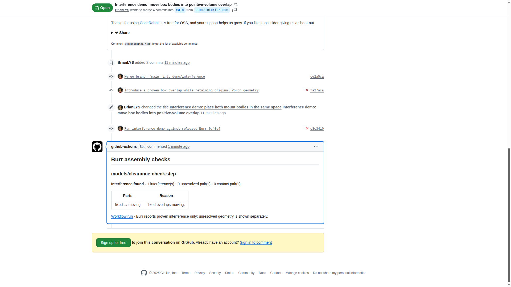

# Burr Action

Check STEP assemblies for interference on every pull request. Burr uses the
geometry in your assembly to report proven interference, contact, and unresolved
pairs separately. Your CAD files stay on the GitHub runner.

```yaml
name: Assembly checks
on: [pull_request]
permissions:
  contents: read
  pull-requests: write # only needed for comment: true
jobs:
  burr:
    runs-on: ubuntu-latest
    steps:
      - uses: actions/checkout@v4
        with:
          persist-credentials: false
      - uses: fraylabs/burr-action@v1
        with:
          comment: 'true'
```



By default, the action checks only added, modified, or renamed `.step` / `.stp`
files in the PR (case insensitive). Deleted files are skipped. Outside a PR it
checks tracked STEP files. Set `files` to newline-separated globs to check a
specific set instead, for example `models/**/*.step`.

Every complete assembly gets a summary such as "105 pairs checked: 3
interfering, 2 touching, all others proven clear", using Burr's checked pair
count and completeness flag. Incomplete assemblies are labelled **INCOMPLETE**
with unresolved pairs and their reasons. Part names and interference reasons
are shown, with contact pairs folded away. An incomplete
check is never called a pass. The optional comment is created or updated by
`github-actions[bot]`; a read-only fork token simply skips the comment with a
warning. Use `pull_request`, never `pull_request_target` to execute untrusted CAD.

| Input | Default | Meaning |
| --- | --- | --- |
| `version` | `0.40.4` | Released Burr version, or `latest` |
| `files` | empty | Newline-separated Python globs, relative to checkout |
| `accepted-fits` | `.burr/accepted.yml` | Optional reviewed list of intended assembly/part pairs |
| `generate-accepted-fits` | `false` | Print a review-required YAML draft and expose `accepted-draft-path`; never auto-accept |
| `fail-on-interference` | `true` | Fail on proven interference |
| `fail-on-unresolved` | `true` | Fail on incomplete checks, import errors, or timeouts |
| `comment` | `false` | Update one PR comment using the workflow token |
| `github-token` | `${{ github.token }}` | Token for changed files and optional comment |
| `burr-token` | empty | Optional Pro/Team secret for hosted history and baseline retrieval |
| `timeout` | `300` | Seconds per assembly (1–3600) |

Linux x64 and macOS x64/arm64 runners are supported. Released binaries are
checksum-verified and cached by version, OS, and architecture. Burr 0.40.4 or
newer is required for `check --json`.

## Intended fits

Threads, press fits and inserts can overlap intentionally. Commit a reviewed
`.burr/accepted.yml` (or set `accepted-fits` to another checkout-relative path):

```yaml
- assembly: models/bracket.step
  parts: [bracket, shoulder_screw]
  reason: Modelled thread engagement is intentional.
```

The unordered part pair uses Burr's displayed names, with generated ` #N`
occurrence suffixes removed when Burr provides the underlying definition name.
Authored suffixes are preserved. Repeated occurrences with the same names share
the policy; use distinct CAD part names if they need separate decisions. Matching
uses the exact assembly path and exact names, with no wildcards. Accepted fits
remain visible with their reasons; unmatched findings still fail. Entries matching
no interference appear as stale warnings. Unresolved pairs and incomplete checks
keep failing, even when a named pair is accepted.

**Burr 0.40.4 does not measure overlap volume.** Its accepted fits are labelled
“accepted by the repo, not measured”; growth detection is deferred. An optional
`max-overlap-mm3` field is enforced only when a checker supplies the finding's
`overlap_volume_mm3`. A larger measured overlap fails with “Accepted fit grew”.
A missing measurement leaves the cap unenforced and produces an explicit warning;
do not rely on a cap for growth protection with the current release.

To prepare the file, set `generate-accepted-fits: 'true'` and select assemblies with
`files`. The Action prints a ready YAML draft and outputs `accepted-draft-path`
for an `if: always()` artifact upload. The draft includes all current findings,
including already accepted ones. Review each pair, remove unwanted entries and
replace every `REVIEW REQUIRED` reason before committing it. Draft generation
does not change the verdict or write the repo's accepted file; committing an
unreviewed draft is rejected. Set `files` to check assemblies when only the
accepted file changes in a PR.

Free checks need no Burr account or token. To enable hosted extras, add
`burr-token: ${{ secrets.BURR_TOKEN }}` under `with`. The client uses the
`https://burr.sh/api/v1` licence, baseline and history API with one total
five-second deadline and no retries. Missing/invalid tokens, malformed
responses, HTTP errors and timeouts skip only hosted extras. Interference and
incomplete checks still fail by default. CAD files are never uploaded; hosted
history contains the JSON report, including part names and local witnesses.
Only supply the secret to workflows whose code you trust. Baselines are read
only; the action never replaces one from a PR. Hosted service availability is
independent of the free check.

Outputs: `status` (`pass`, `interference`, `incomplete`) and `report-path` (a JSON
file containing all raw assembly reports plus accepted and unaccepted findings).
Raw Burr outcomes are preserved; `status` applies repo acceptance policy. To retain the JSON, give the action an
`id` and upload `${{ steps.<id>.outputs.report-path }}` with
`actions/upload-artifact@v4` in an `if: always()` step.

[Passing Voron assembly PR](https://github.com/fraylabs/burr-action-demo/pull/2)
and [failing overlap PR](https://github.com/fraylabs/burr-action-demo/pull/1)
show real checks, uploaded JSON, and a single updated bot comment. The demo
also includes the licensed Voron and openAMR corpus assemblies.

MIT license. Burr itself: [fraylabs/burr](https://github.com/fraylabs/burr).
